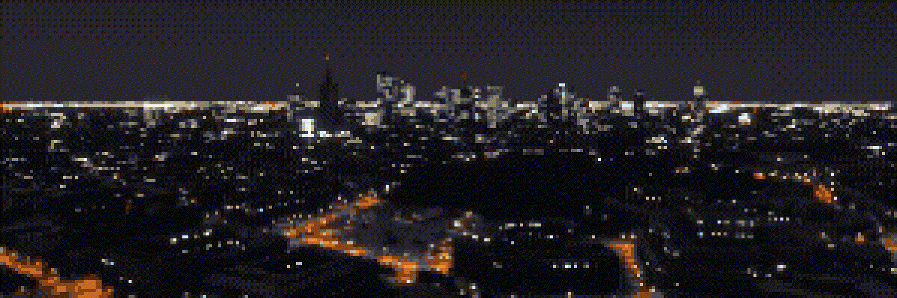
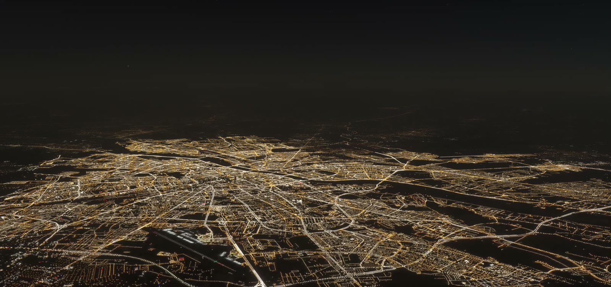
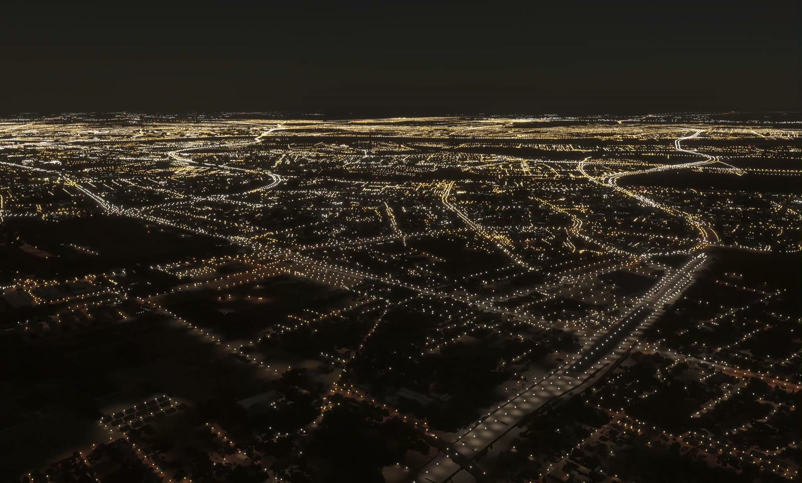

# Warsaw by Night

Night lighting for Warsaw in **Microsoft Flight Simulator 2024**. Every surveyed street lamp in the city gets a 3D
post and real light on the road, plus glow you can see from the approach and from cruise altitude. MSFS's own
generated street lights are switched off inside the city, so nothing doubles up.

**[Download the latest version](https://github.com/Tolya1/WarsawByNightReleases/releases/latest)** (free).

This repository holds the releases, instructions and issue tracker. The scenery itself is built from data by a
separate, private project.

## What's in it

- **About 274,000 lamps** from the City of Warsaw's street-lamp survey, with OpenStreetMap lamps and generated lamps
  filling gaps.
- **3D lamp posts** at every lamp: LED arm, double-arm T pole, sodium cobra head, residential, lantern, bollard, high
  mast.
- **Real light on the road** that reaches far ahead without block pop-in.
- **Realistic colours** from the city's LED tender: 4000 K on main roads, 3000 K on local streets, orange sodium where
  it remains.
- **Glow visible from far away:** halos at every lamp, plus baked ground glow that keeps the city lit on a long
  approach.
- **MSFS default street lights switched off** inside the city boundary.
- **Airports left alone:** no lamps inside airport boundaries, so airport sceneries such as Drzewiecki Design EPWA
  keep their own apron lighting.
- Red obstruction lights on masts and towers, floodlit sports grounds, fuel stations.

## Install

1. Close MSFS.
2. Download `rb-warsaw-by-night-<version>.zip` from [Releases](https://github.com/Tolya1/WarsawByNightReleases/releases)
   and unzip it.
3. Put the `rb-warsaw-by-night` folder into your MSFS 2024 **Community** folder, or link it with your add-on linker.
4. Fly to Warsaw at night.

Full instructions, recommended settings and known limitations: [INSTALL.md](INSTALL.md).

## Problems and suggestions

Open an [issue](https://github.com/Tolya1/WarsawByNightReleases/issues) with a screenshot and your position (or the
street name).

## Credits

Street-lamp positions: Urząd m.st. Warszawy. Map data © OpenStreetMap contributors (ODbL). Terrain: GUGiK. LED colour
temperatures: ZDM. Full list: [CREDITS.md](CREDITS.md). Not affiliated with or endorsed by Microsoft, Asobo Studio or
the data owners.

Version history: [CHANGELOG.md](CHANGELOG.md).
